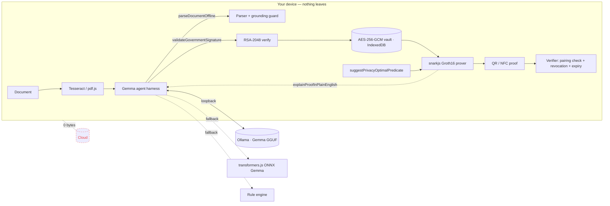

<div align="center">

# 🛡️ VaultZK Engine

### Prove Anything. Reveal Nothing.

Zero-trust, zero-knowledge eligibility verification powered by an **on-device Gemma agent** and real **Groth16 zk-SNARKs**.
Documents are parsed locally, sealed with AES-256-GCM and proven with mathematics. **Zero bytes ever touch the cloud.**

[](LICENSE)
[](docs/GEMMA.md)
[](#license)
[](tsconfig.json)
[](SKILL.md)

</div>

---

## Overview

Every day billions of people over-share Aadhaar, PAN, bank statements and birth dates just to answer yes/no questions.
VaultZK flips this: you prove **“age ≥ 21”**, **“balance ≥ $50,000”** or **“(A AND B) OR C”** without revealing the data behind it.

1. **Upload locally** — PDF, photo, Aadhaar XML, PAN. OCR (Tesseract WASM) and PDF text extraction run in your browser.
2. **Gemma parses on-device** — a local Gemma agent calls structured tools, validates the RSA-2048 government signature and rejects forgeries.
3. **Generate a proof** — a Circom/Groth16 circuit proves a predicate. The QR carries the SNARK, never the data, and self-destructs (time-bomb bound *inside* the proof).
4. **Verify anywhere** — scan a QR, paste JSON or tap NFC. Pairing check ≈ tens of ms, fully offline.

> The in-app **▶ Watch 60s Demo** walks through the flow; Settings → Developer Mode exposes circuit internals, the Gemma tool-call console and a profiler.

## Features

| # | Feature | Where | Status |
|---|---------|-------|--------|
| 1 | Local ZK-Vault: AES-256-GCM, non-extractable key in IndexedDB (Dexie), PIN / biometric (simulated) lock | `/vault`, `/settings` | ✅ |
| 2 | Government signature validator (RSA-2048 / SHA-256, Web Crypto, forged-document rejection) | `src/lib/signature.ts` | ✅ |
| 3 | ZK engine: real snarkjs Groth16, `range` + `logic` circuits | `circuits/`, `src/lib/zk.ts` | ✅ |
| 4 | Universal verifier: webcam QR (jsQR), image upload, paste JSON, verified/expired/revoked/invalid | `/verify` | ✅ |
| 5 | Time-bomb proofs 10 s – 24 h, expiry bound in the SNARK public inputs | `/generate` | ✅ |
| 6 | Multi-condition logic: `(A AND B) OR (C AND NOT D)` via drag-and-drop builder, hides the satisfied branch | `/generate` → Custom | ✅ |
| 7 | NFC tap-to-prove simulation (real verification, computed 424 kbps transmission) + Web NFC tag write | `/nfc` | ✅ simulation |
| 8 | Privacy audit: 6 charts, filters, sortable/expandable log, PDF privacy receipts, bulk ops | `/audit` | ✅ |
| 9 | Kill-switch: global panic button, selective revoke, revocation gossip over `BroadcastChannel` | header | ✅ |

### Honest scope notes

* **NFC** — browsers cannot act as NFC card emulators, so the tap is a simulation. Verification inside it is real; transmission time is computed from payload size at the NFC data rate. Web NFC tag writing is wired for Android Chrome.
* **Gossip** — revocation lists are merged between tabs/windows via `BroadcastChannel`; a network gossip transport is on the roadmap.
* **Trust anchors & ceremony** — shipped anchors are demo RSA keys and the Groth16 setup is a single-party dev ceremony. Replace both for production (see [SECURITY.md](SECURITY.md)).
* **Binding documents to proofs** — values in the vault come from signed documents, but the circuit does not (yet) verify the signature in-circuit. See [docs/ZK-CIRCUITS.md](docs/ZK-CIRCUITS.md#roadmap).
* **Gemma versions** — the model tag is configurable (`gemma2:2b` default). Point Settings → Gemma AI at any Gemma tag your Ollama has, e.g. a newer generation.
* **Audit seed data** — first launch seeds *clearly flagged synthetic* history so charts aren’t empty; clear it any time.

## Architecture



More in [docs/ARCHITECTURE.md](docs/ARCHITECTURE.md).

## Installation

Requirements: Node.js 20+, npm, and (recommended) [Ollama](https://ollama.com).

```bash
git clone https://github.com/vaultzk/vaultzk-engine.git
cd vaultzk-engine
npm install

# 1. local Gemma (once, online)
ollama pull gemma2:2b

# 2. run
cp .env.example .env
npm run build && npm start        # http://localhost:3000
# or: npm run dev
```

Everything needed offline is vendored in `public/` (`zk/` circuits + zkeys + snarkjs, `ocr/` Tesseract worker/core/English data, `pdfjs/` worker). A service worker caches the app shell so it keeps running with Wi-Fi off.

### Regenerating ZK artifacts (optional)

```bash
# install circom 2.1.x: https://docs.circom.io/getting-started/installation/
CIRCOM_BIN=$(which circom) node scripts/setup-zk.mjs   # compiles circuits, runs Groth16 setup
node scripts/generate-samples.mjs                      # new demo trust anchors + signed sample docs
node scripts/test-zk.mjs                               # prove/verify smoke test
```

### Docker

```bash
docker compose up --build        # app on :3000 + Ollama on :11434
docker compose exec ollama ollama pull gemma2:2b
```

## Usage

1. **Vault Setup** → load *Bank statement (signed)* → watch the agent console: `parseDocumentOffline`, `validateGovernmentSignature`, AES-GCM, IndexedDB. Try *Forged statement* to see rejection.
2. **Generate Proof** → Financial → *Bank balance ≥ $50,000* → 60 s → **Generate**. Copy the payload or share the link.
3. **Verify Proof** → scan the QR / paste JSON → confetti + *MATHEMATICALLY VERIFIED*.
4. **NFC Tap** → *Simulate NFC Tap* → sub-200 ms offline result.
5. **Privacy Audit** → charts → open a row → *Receipt* → PDF.
6. **Panic** → header button → verify the same proof again → *REVOKED*.

## Gemma integration

See [docs/GEMMA.md](docs/GEMMA.md) and [SKILL.md](SKILL.md). Summary:

* Inference engines in priority order: **Ollama** (loopback via `/api/gemma/generate`) → **transformers.js** ONNX Gemma in the browser → deterministic **rule engine**. The active engine is always visible in the header.
* Four tools — `parseDocumentOffline`, `validateGovernmentSignature`, `suggestPrivacyOptimalPredicate`, `explainProofInPlainEnglish` — zod-validated, timestamped in the live console.
* Gemma plans tool order as JSON; a guardrail enforces required tools; model output is grounded against source text.

## ZK-SNARK circuits

| Circuit | Statement | Constraints | Public signals |
|---|---|---|---|
| `range.circom` | `value ≥ threshold` (48-bit) + Poseidon commitment | 291 | commitment, threshold, nonce, expiry, predicate |
| `logic.circom` | `(c0 ∧ c1) ⟨AND/OR⟩ (c2 ∧ c3)`, per-slot NOT | 536 | commitment, 4×threshold, 4×field, 4×neg, op, nonce, expiry |

Details: [docs/ZK-CIRCUITS.md](docs/ZK-CIRCUITS.md).

## API reference

Internal routes (loopback only, no user data persisted): `GET /api/health`, `GET /api/gemma/status`, `POST /api/gemma/generate`, `POST /api/gemma/pull`. Library API and the proof payload format: [docs/API.md](docs/API.md).

## Project layout

```
circuits/            range.circom, logic.circom
scripts/             setup-zk.mjs, generate-samples.mjs, test-zk.mjs
public/zk|ocr|pdfjs|samples   offline artifacts
src/lib/gemma/       agent harness, tools, engines
src/lib/             zk, crypto, signature, vault, proofs, pipeline
src/app/             landing + 7 app pages + API routes
SKILL.md             Open Agent Skill manifest
```

Design tokens (Navy `#0b0f19`, Cyan `#06b6d4`, Green `#22c55e`, Red `#ef4444`, Inter + JetBrains Mono) live in `src/app/globals.css` via Tailwind v4 `@theme`.

## Contributing

See [CONTRIBUTING.md](CONTRIBUTING.md) and the [Code of Conduct](CODE_OF_CONDUCT.md). Security issues: [SECURITY.md](SECURITY.md).

## License

[MIT](LICENSE) © VaultZK contributors.

## Credits

Google Gemma · Ollama · iden3 (circom, circomlib, snarkjs) · Hugging Face transformers.js · Tesseract.js · pdf.js · Dexie · Radix UI · Recharts · Framer Motion.

## Links

* Interactive demo: run locally and click **▶ Watch 60s Demo** on the landing page.
* Agent Skill manifest: [SKILL.md](SKILL.md)
