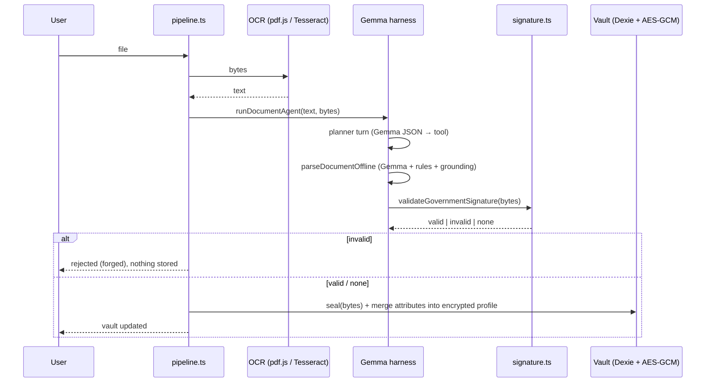

# Architecture

VaultZK is a **client-side-first** Next.js (App Router) application. The server exists only to serve static assets,
proxy the loopback Ollama daemon, and answer `/api/health`. No user data is ever sent to or stored on the server.

## Layers

| Layer | Module | Notes |
|---|---|---|
| UI | `src/app/**`, `src/components/**` | Tailwind v4 tokens in `globals.css`, Radix primitives (`ui.tsx`), Framer Motion |
| State | `src/lib/store.ts` (Zustand) | UI prefs persisted to `localStorage`; Gemma status + tool-call log in memory |
| Storage | `src/lib/db.ts` (Dexie / IndexedDB) | tables: `documents`, `secrets`, `proofs`, `verifications`, `events`, `revocations`, `meta` |
| Crypto | `src/lib/crypto.ts` | AES-256-GCM, non-extractable master `CryptoKey`, PBKDF2-SHA256 (210k) for PIN / backup keys |
| Signatures | `src/lib/signature.ts` | RSA-2048 / SHA-256 detached signature trailer verified with Web Crypto |
| ZK | `src/lib/zk.ts`, `circuits/`, `public/zk/` | snarkjs UMD bundle vendored; Groth16 on BN254 |
| AI | `src/lib/gemma/**` | engine router, tools, planner harness, rule engine |
| Ingest | `src/lib/ocr.ts`, `src/lib/pipeline.ts` | pdf.js / Tesseract → agent → signature → encrypt → store |

## Document ingestion sequence

## Proof lifecycle

1. `generateProof(spec, profile, opts)` builds the witness (`wtns.calculate`) then `groth16.prove`.
2. The payload `{v, id, circuit, proof, signals, issuedAt, verifier?}` is compacted (affine points only).
   `id = vzk_ + sha256(circuit, proof, signals)[0:12]` – changing any byte changes the ID, so revocation can’t be dodged by relabeling.
3. `verifyPayloadText` → zod structure → recompute ID → Groth16 verify → revocation list → expiry (from the proven public signal).

## Revocation

`revokeProofs` writes to the `revocations` table and broadcasts IDs on `BroadcastChannel("vaultzk-revocations")`;
peers merge them (`source: "gossip"`). `panicRevokeAll` revokes every non-expired proof. `revocationDigest` is a SHA-256 over the sorted list.

## Offline

`public/sw.js` is a network-first/caches-fallback service worker. Large assets (`zk/*.wasm`, `*.zkey`, OCR data) are cached after first fetch.
Unit-level offline verification needs only `public/zk/*_vkey.json`.

## Security boundaries

* The master key is non-extractable; PIN/biometric gate the **UI** (see SECURITY.md for the threat model).
* Server routes never receive documents or proofs. `/api/gemma/generate` receives prompts (document text) and forwards to the *local* Ollama daemon only.
